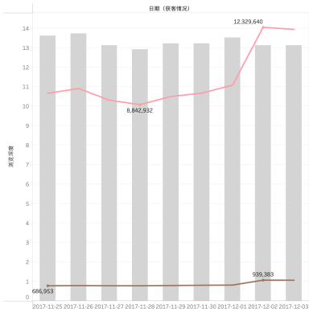
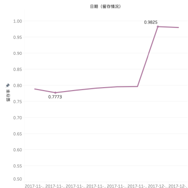
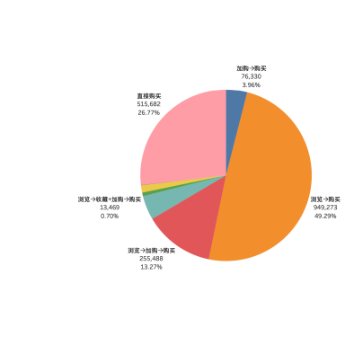
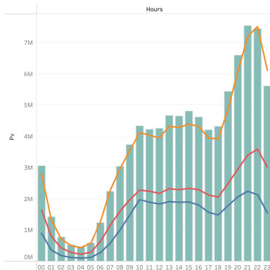
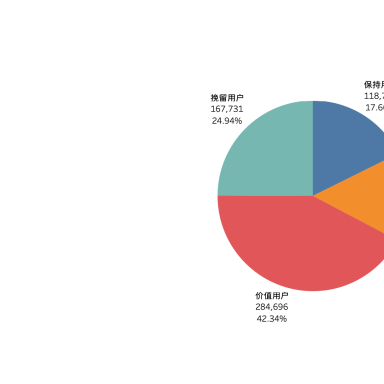
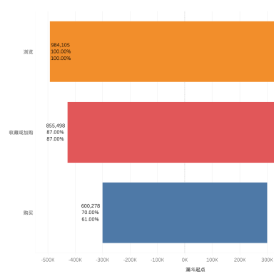

# 淘宝用户行为分析

使用 **MySQL 与 Tableau**，围绕用户活跃、留存、购买行为和商品表现开展数据分析。分析时间范围为 **2017年11月25日至12月3日**，使用全量约1亿条用户行为记录。

仓库中的 SQL、Tableau 和 Xmind 均为个人项目的原始文件，保留原始内容和命名。图表直接提取自原始 Tableau 工作簿保存的预览，没有重新绘制。

## 项目内容

- **数据预处理**：空值检查、重复记录处理、时间字段加工和异常日期过滤。
- **用户分析**：PV、UV、浏览深度、留存、日期与小时行为、用户转化、购买行为组合及漏斗分析。
- **用户分层**：按照最近购买日期和购买频次进行分层。原文件沿用“RMF/RFM”命名，实际不含金额维度。
- **商品分析**：热门品类、热门商品、品类内热门商品，以及商品和品类的购买用户占比。
- **可视化**：使用 Tableau 展示分析结果并组织看板。

## 原始图表

下图是原工作簿中保存的看板缩略图。预览分辨率有限，部分内容受原缓存尺寸影响；完整图表请下载原始工作簿查看。

| 访客情况 | 留存情况 | 购买行为组合 |
| --- | --- | --- |
|  |  |  |

| 小时行为 | 用户分层 | 漏斗分析 |
| --- | --- | --- |
|  |  |  |

全部原始图表预览见 [`assets/`](assets/)。`overview.png` 与原始“看板”预览为相同图片，保留这一文件名以兼容原展示链接。

## 原始项目文件

| 文件 | 内容 |
| --- | --- |
| [`sql查询/`](sql查询/) | 10个主要分析SQL文件及1个临时SQL文件，均保持原始内容 |
| [`taobao_time_behavior.twb`](taobao_time_behavior.twb) | 原始Tableau工作簿，包含12个工作表和看板 |
| [`中心主题.xmind`](中心主题.xmind) | 原始项目思维导图 |

主要SQL文件依次为：数据预处理、获客情况、留存情况、时间序列分析、用户转化率分析、用户路径分析、漏斗分析、RMF模型、商品按热度分类、商品转化率分析。

SQL文件包含项目过程中的分步探索、建表和结果保存语句，保留原有写法，供结合分析思路阅读。Tableau工作簿连接本地MySQL；下载后需要在自己的环境中配置连接和结果表。GitHub不能直接交互运行工作簿，仓库中的图片用于在线预览。

## 数据来源

数据来源为[阿里云天池淘宝用户购物行为数据集](https://tianchi.aliyun.com/dataset/649)，包含用户、商品、品类、行为类型和时间戳。行为类型包括浏览、收藏、加购和购买。

原始完整数据文件不随仓库上传，可从来源页面获取。本项目没有交易金额或订单明细，不据此计算GMV、客单价或实际业务收益提升。
