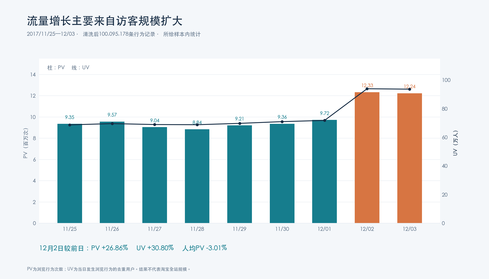
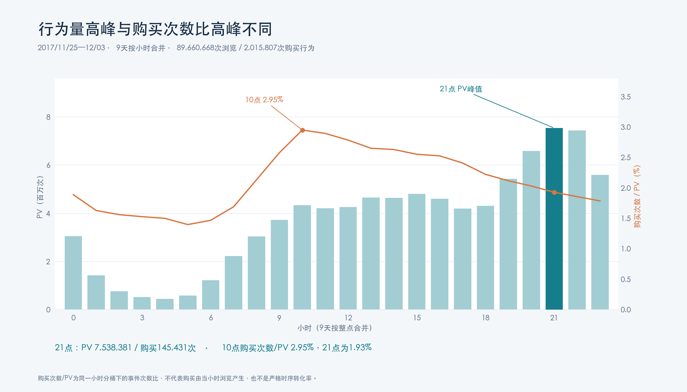
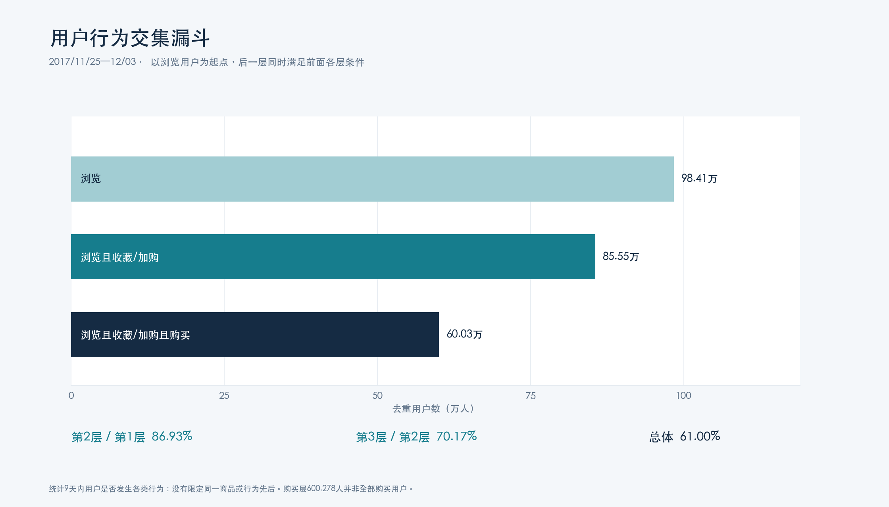
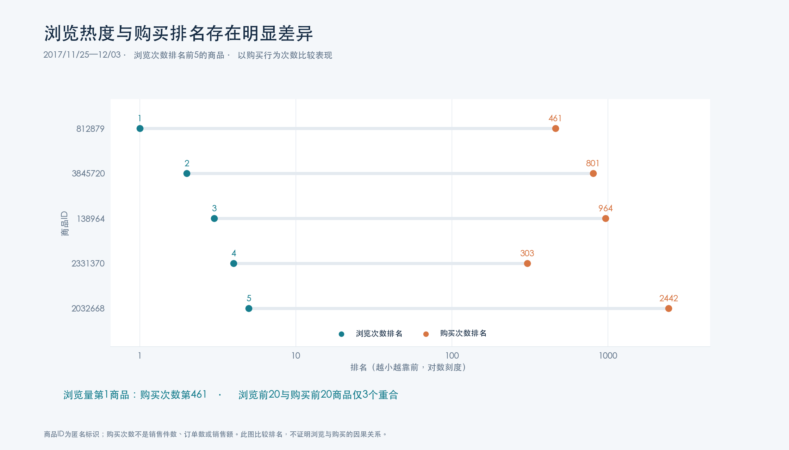

# 淘宝用户行为与商品转化分析

基于淘宝用户购物行为数据，使用 **MySQL 与 Tableau** 分析用户活跃、留存、购买行为组合、RF 用户分层，以及商品热度与购买表现。数据覆盖 **2017 年 11 月 25 日至 12 月 3 日**，共 9 天。

项目从数据清洗、指标计算、专题分析到看板展示形成完整流程，并提供聚合结果和独立的全量复现脚本。


## 核心发现

| 问题 | 分析结果 |
| --- | --- |
| 流量增长来自访客数还是浏览深度？ | 12 月 2 日 PV 较前日增长 **26.86%**，UV 增长 **30.80%**，人均浏览深度下降 **3.01%**。增长主要来自访客规模扩大。 |
| 用户何时最活跃？ | 9 天按小时合并后，**21 点浏览与购买次数最高**；20—22 点贡献 **24.05%** 的 PV。 |
| 行为量高峰是否也是购买次数比高峰？ | 10 点的购买次数/PV 为 **2.95%**，高于 21 点的 **1.93%**。两个指标需要分别观察。 |
| 浏览、收藏/加购与购买的人群覆盖如何？ | 三层行为交集人数依次为 **984,105 → 855,498 → 600,278**；总体比例 **61.00%**，后两层比例 **70.17%**。 |
| 购买用户具有什么行为组合？ | 按用户—商品粒度统计 8 类组合，其中“浏览＋购买”占 **49.29%**，“仅购买”占 **26.77%**。 |
| 热门商品是否也是购买最多的商品？ | 浏览量第 1 的商品，购买次数仅排 **第 461**；浏览前 20 与购买次数前 20 的商品只有 **3 个重合**。 |

以上均为所给数据集在观察窗口内的统计。项目产出是分析结论与可视化，不声称已经取得实际业务指标提升。

## 数据与工具

| 项目 | 内容 |
| --- | --- |
| 数据来源 | [阿里云天池：淘宝用户购物行为数据集](https://tianchi.aliyun.com/dataset/649) |
| 原始记录 | 100,150,807 条 |
| 清洗后记录 | 100,095,178 条 |
| 用户 | 987,991 人 |
| 商品与品类 | 4,161,138 个商品，9,437 个品类 |
| 行为 | 浏览 `pv`、收藏 `fav`、加购 `cart`、购买 `buy` |
| 主要工具 | MySQL 8、Tableau |
| 复核工具 | Python、DuckDB；提供完整数据重算、合成样本核对及聚合结果 |

原始数据从来源页面获取，使用时遵循来源页面说明。仓库只保存聚合统计，不包含原始行为明细或完整数据压缩包。

## 分析流程

1. **清洗与加工**：检查空值，按用户、商品、时间戳去重，保留首条记录；过滤窗口外数据，生成日期与小时字段。原始表保留，分析使用独立清洗表。
2. **活跃与留存**：计算每日 PV、UV、人均 PV 和活跃人群次日留存，通过日期、小时拆解四类行为。
3. **购买行为分析**：分别统计用户数与行为次数，构建期内行为交集漏斗，按用户—商品粒度统计购买行为组合。
4. **RF 分层**：依据最近购买日期和购买次数评分，将购买用户划分为价值、发展、保持、挽留四类。
5. **商品分析**：比较商品与品类的浏览热度、购买次数、购买用户占比，交叉检查浏览与购买排名。
6. **展示与核对**：通过 Tableau 组织分析视图；用聚合结果重新绘制清晰的静态图，并对日期、小时、商品、品类汇总总量进行交叉核对。

## 图表展示

**每日流量：** 12 月 2 日的增长主要来自 UV 扩大，人均浏览深度没有同步增加。



**小时分布：** 21 点是行为量高峰，10 点的购买次数/PV 更高。



**漏斗：** 按同一观察窗口统计嵌套人群，分别计算层间与总体比例。



**商品对比：** 浏览热度与购买次数排名存在明显差异。



## 指标口径

- **UV**：当日发生浏览行为的去重用户数，用于描述访客活跃情况，不等同于新增用户数。
- **次日留存**：某日发生任意行为的用户，在次日仍发生任意行为的比例。窗口末日不可观测，保留为空值。
- **三层漏斗**：用户在 9 天内是否出现浏览、收藏/加购、购买的行为交集；没有强制时间先后或同一商品约束。
- **购买行为组合**：同一用户对同一商品在窗口内出现过哪些行为，不将组合中的加号解读为真实先后顺序。
- **RF 分层**：缺少金额字段，因此使用 R、F 两维。公开版对同购买次数按 `user_id` 排序，明确均值计算及边界处理，使分组可复现。
- **商品购买用户占比**：该商品购买去重用户数 / 对该商品发生任意行为的去重用户数。它不同于严格的浏览后购买转化率。
- **购买次数/PV**：两个事件次数的比值，不能直接解读为浏览事件在随后转化的概率。

完整定义、评分规则和观察窗口限制见 [指标说明](docs/metrics.md)。

## 项目文件

```text
.
├── README.md
├── sql/                   # 按编号执行的 MySQL 8 分析脚本
├── tableau/               # 清理连接信息并修正公式的 Tableau 工作簿
├── assets/                # 根据聚合结果绘制的图表
├── data/aggregate/        # 全量计算后的聚合 CSV 与 JSON
├── scripts/               # 可移植的全量复现与图表生成脚本
├── docs/
│   ├── findings.md        # 逐项分析结果
│   ├── metrics.md         # 指标、分层与局限
│   ├── reproduce.md       # 原始数据准备与 Python 复现
│   ├── sql-methodology.md # MySQL 执行与实现说明
│   └── tableau.md         # 数据连接和刷新方法
└── requirements.txt
```

## 查看与复现

无需本地数据库即可查看 [逐项分析结果](docs/findings.md)、[聚合数表](data/aggregate/) 和上方图表。

MySQL 实现见 [`sql/`](sql/) 与 [SQL 执行说明](docs/sql-methodology.md)。Tableau 工作簿见 [`tableau/`](tableau/)，连接本地结果表后刷新数据，具体见 [Tableau 使用说明](docs/tableau.md)。

也可以使用 Python 对完整原始数据独立复核：

```bash
python -m pip install -r requirements.txt
python scripts/recompute.py \
  --source data/raw/UserBehavior.csv.zip \
  --output results/recomputed \
  --verify-reference
```

`--verify-reference` 只适用于完整的对应版本数据集，用于验证关键行为总量。自己的样本应省略该参数。更多选项与磁盘准备见 [复现说明](docs/reproduce.md)。
