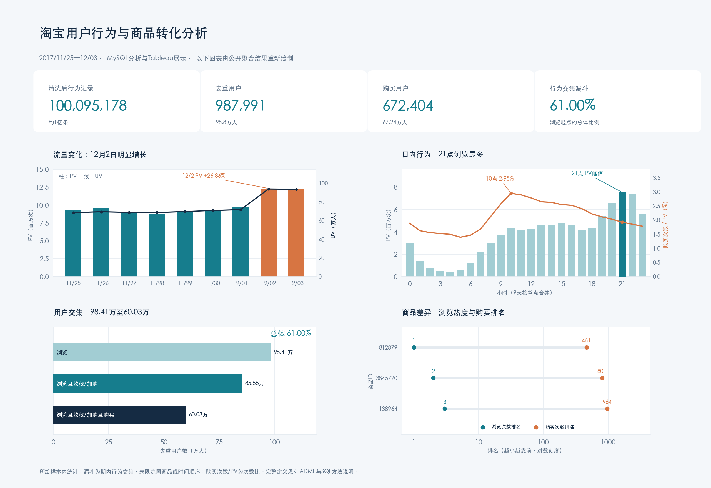

# 淘宝用户行为分析

本项目围绕电商运营中的三个判断展开：**流量增长是否伴随更深的访问，收藏/加购与购买的人群覆盖是否匹配，以及应优先关注哪些用户和商品。**

使用 MySQL 对全量约1亿条用户行为记录进行清洗与分析，并通过 Tableau 展示结果。分析从业务问题出发，将浏览、收藏、加购和购买拆解为流量质量、用户经营与商品表现的判断依据。

## 项目看板

[查看原尺寸看板](https://github.com/WonderHow1/taobao-user-behavior-analysis/blob/c5b10ec9dc1289b051d092c1104f6c0a9201fd81/assets/overview.png)。

## 原始文件说明

| 文件 | 内容 |
| --- | --- |
| [`sql查询/`](sql查询/) | 10个主要分析SQL文件及1个临时SQL文件，保留原始内容和命名 |
| [`taobao_time_behavior.twb`](taobao_time_behavior.twb) | 原始Tableau工作簿，包含12个工作表和看板 |
| [`中心主题.xmind`](中心主题.xmind) | 原始项目思维导图 |

## 数据范围与分析框架

- **数据来源**：[阿里云天池淘宝用户购物行为数据集](https://tianchi.aliyun.com/dataset/649)。
- **观察窗口**：2017年11月25日至12月3日，共9天。
- **数据字段**：用户ID、商品ID、品类ID、行为类型、时间戳。
- **业务视角**：访客规模与浏览深度 → 活跃与回访 → 意向与购买覆盖 → 用户分层 → 商品表现。
- **实现方式**：MySQL完成数据处理、指标计算及分组分析，Tableau组织分析视图和看板。

在整个9天窗口内，分别按用户ID去重，浏览用户为 **984,105人**，购买用户为 **672,404人**；期间产生 **89,660,668次浏览**、**2,015,807次购买行为**。每日UV只在当日去重，不能相加得到整窗去重人数。人数与次数分开解读，避免把重复访问或重复购买混为用户规模增长。

完整定义见[数据指标与口径](数据指标与口径.md)，包括统计范围、去重粒度、计算公式、分母以及原SQL和Tableau中的口径差异。

## 主要发现与业务解读

按原始SQL文件的顺序和名称展开：**01为数据准备，02—08围绕“人”分析访问、回访、行为与用户分层，09—10围绕“货”分析品类和商品的关注热度与购买表现。** 各节标注对应的原始SQL与Tableau图表，便于结合上方看板阅读。

### 01 数据预处理

原始SQL：[`01 数据预处理.sql`](sql查询/01%20数据预处理.sql)。本节为数据准备。

对全量约1亿条记录检查缺失值、重复值和异常时间，按用户、商品及时间戳识别重复记录，并将时间戳拆解为日期与小时，统一2017年11月25日至12月3日的观察窗口。

数据准备的业务意义在于统一后续分析的时间范围与统计基础，避免重复记录放大行为次数、异常日期干扰趋势。后续同时区分用户数与行为次数，并在用户、用户—商品组合、商品和品类等不同粒度下解释指标。

### 02 获客情况

原始SQL：[`02 获客情况.sql`](sql查询/02%20获客情况.sql)。对应Tableau图表：**《获客情况图》**。

以PV、UV和人均PV判断流量变化。12月2日PV为 **12,329,640**、UV为 **939,383**；相比前一天，PV增长 **26.86%**、UV增长 **30.80%**，人均浏览深度下降 **3.01%**。

这次增长主要来自访客规模扩大，没有伴随人均浏览加深。因此，判断流量质量时，需要进一步看这些访问是否延续为回访、意向行为和购买，不能只用PV增长代表整体运营效果。现有数据描述的是访客情况，缺少渠道和首次访问标签，UV增长不直接等于新增用户增长。

### 03留存情况

原始SQL：[`03留存情况.sql`](sql查询/03留存情况.sql)。对应Tableau图表：**《留存情况图》**。

留存以某日发生任意行为的活跃用户为分母，观察其中有多少人在次日仍有行为。11月25日至30日，各日活跃人群的次日留存为 **77.73%—79.63%**；12月1日、2日分别为 **98.25%、97.98%**，12月3日没有次日观测结果。

这一分析把“当日规模”与“后续回访”连接起来。后段回访覆盖更高，值得继续拆分人群结构和访问来源，但9天窗口不足以判断长期粘性，也不能将变化直接归因于某项运营活动。对增长人群的经营，应同时跟踪后续回访和购买，而不只关注当天访问。

### 04 时间序列分析

原始SQL：[`04 时间序列分析.sql`](sql查询/04%20时间序列分析.sql)。对应Tableau图表：**《用户行为趋势图（日）》《用户行为趋势图（小时）》《用户行为趋势图（日+小时）》**。

按日期和小时拆解浏览、收藏、加购与购买，区分每日规模变化和日内行为节奏。9天合并后，**21点浏览与购买次数最高，22点收藏与加购次数最多**。

不同指标的峰值并不完全一致，运营排期需要结合目标行为：关注访问与购买时，可优先观察21点附近；关注意向积累时，可进一步比较22点的收藏和加购人群。高峰提供候选时段，实际触达安排仍需结合目标人群验证，不能仅凭行为量高就推断该时段转化效率最高。

### 05 用户转化率分析

原始SQL：[`05 用户转化率分析.sql`](sql查询/05%20用户转化率分析.sql)。对应Tableau图表：**《用户行为数量对比图》**，上半部分展示行为次数，下半部分展示去重用户数。

分别统计四类行为的覆盖人数与发生次数：

| 行为 | 窗口内去重用户数 | 行为次数 |
| --- | ---: | ---: |
| 浏览 | 984,105 | 89,660,668 |
| 收藏 | 389,823 | 2,888,258 |
| 加购 | 738,996 | 5,530,445 |
| 购买 | 672,404 | 2,015,807 |

人数用于观察覆盖范围，次数用于观察行为强度。加购人数多于收藏人数，说明两类意向行为的覆盖存在差异，可以作为后续人群拆分的起点；这并不代表加购一定先于购买，也不能据此判断哪类行为更能促进购买。

各类用户有重叠，不能相加；独立统计的购买人数与浏览人数之比，也不能直接解释为浏览用户的购买转化率。要理解人群之间的衔接，需要进一步结合用户路径与漏斗分析。

### 06 用户路径分析

原始SQL：[`06 用户路径分析.sql`](sql查询/06%20用户路径分析.sql)。对应Tableau图表：**《用户购买行为路径》**。

以发生购买的用户—商品组合为单位，共 **1,926,027组**，归纳出8类行为组合。其中“浏览＋购买”占 **49.29%**，“仅购买”占 **26.77%**，“浏览＋加购＋购买”占 **13.27%**。

购买对应的行为组合具有多样性，不宜把收藏或加购设为所有购买都必须经过的环节。这里的分母是全部购买组合，不是用户数或订单数；SQL按行为是否出现分类，没有验证时间先后，因此图中的箭头应理解为组合标签。“仅购买”也只表示窗口内没有记录到该用户对该商品的其他行为。

经营分析可以据此区分不同购买组合，再在同商品、同观察时长和明确先后顺序下研究购买过程，避免把缺少收藏或加购记录一概视为流失。

### 07 漏斗分析

原始SQL：[`07 漏斗分析.sql`](sql查询/07%20漏斗分析.sql)。对应Tableau图表：**《转化漏斗图》**。

按同一观察窗口内的用户行为交集构建三层漏斗，后一层同时满足前面各层的条件：

| 人群层级 | 用户数 | 相对上一层比例 | 相对浏览层比例 |
| --- | ---: | ---: | ---: |
| 有浏览行为 | 984,105 | 100.00% | 100.00% |
| 有浏览且有收藏或加购行为 | 855,498 | 86.93% | 86.93% |
| 同时有浏览、收藏/加购及购买行为 | 600,278 | 70.17% | 61.00% |

后两层之间的覆盖比例更低，值得优先分析意向人群与购买记录之间的差异。不过，这里没有限定同一商品或行为先后，不能直接解释为支付流程流失。

漏斗观察的是用户层面的覆盖，上一节观察的是购买用户—商品组合。两者结合，可以提出更具体的问题：有意向但没有购买记录的人群集中在哪些商品，是否仍在回访，后续是否购买。具体原因还需补充商品、会话或订单信息验证。

### 08 RMF模型

原始SQL：[`08 RMF模型.sql`](sql查询/08%20RMF模型.sql)，沿用原文件命名。对应Tableau图表：**《用户分层（RFM模型）》**；数据缺少金额M，实际使用R、F两个维度。

对窗口内 **672,404名购买用户**，以最近购买日期R和购买次数F评分：R评分越高表示最近购买越近，F按购买次数分箱；高低分别相对各自评分均值划分。

| 人群 | R/F评分组合 | 对应的经营关注点 |
| --- | --- | --- |
| 价值用户 | R高、F高 | 观察持续购买与活跃，评估相关内容或权益是否有助于保持响应 |
| 发展用户 | R高、F低 | 观察近期购买后的回访与再次购买，验证适当引导是否有效 |
| 保持用户 | R低、F高 | 结合近期浏览与历史购买，判断兴趣是否持续，再观察后续购买响应 |
| 挽留用户 | R低、F低 | 先判断是否仍有浏览或加购，再小范围验证触达的必要性 |

这一环节将整体行为分析细化到人群经营。窗口内没有购买记录，不代表用户从未付费；最近购买较早，也不等于近期不活跃。分层需要与浏览、收藏和加购行为结合解释；等人数分箱还可能将相同购买次数的用户分到不同评分，不能将规则标签直接当作长期客户价值。

### 09 商品按热度分类

原始SQL：[`09 商品按热度分类.sql`](sql查询/09%20商品按热度分类.sql)。对应Tableau图表：**《商品热度排名（前二十名）》实际展示品类数据，《品类热度排名（前二十名）》实际展示商品数据**，此处沿用原图标题说明对应关系。

从“人”转向“货”，按PV形成三个层次的榜单，分别回答不同问题：

| 分析层次 | 实际统计方式 | 业务用途 |
| --- | --- | --- |
| 热门品类 | 按品类汇总浏览次数，取前20 | 了解用户关注集中在哪些品类 |
| 热门商品 | 按商品汇总浏览次数，取前20 | 识别全样本中关注较集中的单品 |
| 各品类内热门商品 | 先取各品类内PV排名第1（含并列）的商品，再按商品PV选前20条展示；见SQL结果，未单独绘图 | 观察品类内部的关注对象，补充总体商品榜单的视角 |

例如，品类 **4756105** 有 **4,477,682次浏览**；其内商品 **812879** 有 **30,079次浏览**，也是全样本中浏览最多的单品。品类规模与单品关注度属于不同层次，不能用一个总体热度排名代替所有商品判断。

热门榜单反映关注集中度，本身按浏览量排序。判断这些关注是否对应购买表现，还需要结合收藏、加购、购买与覆盖人数进一步分析。

### 10 商品转化率分析

原始SQL：[`10 商品转化率分析.sql`](sql查询/10%20商品转化率分析.sql)。本节依据 **`item_detail`、`category_detail`查询结果**。

在商品和品类两个粒度上，分别统计浏览、收藏、加购、购买次数及购买用户占比。**购买用户占比＝购买去重用户数／对该商品或品类发生任意行为的去重用户数**，需要同时查看分母规模。

| 品类ID | 浏览次数 | 购买行为次数 | 购买用户占比 |
| --- | ---: | ---: | ---: |
| 4756105 | 4,477,682 | 28,258 | 5.69% |
| 4145813 | 3,150,716 | 31,658 | 7.28% |

前一个品类浏览更多，后一个品类购买行为更多。这说明关注规模与购买表现需要分别评价；品类之间还存在需求、商品数量和购买周期差异，不能据此直接判断品类优劣。

单品层面，商品 **812879** 有 **136次购买行为**，其 **21,516名行为用户中125名购买**，购买用户占比约 **0.58%**。将浏览量、购买覆盖和样本量联合观察，才能提出具体诊断问题；是否表现偏低，还应与同品类、同生命周期商品比较，不能仅因进入热门榜单就决定追加流量或补货。

进一步结合四类行为，可追问高关注商品的意向行为与购买覆盖是否同向，以及有意向记录却缺少购买记录的对象有何差异。价格、库存、商品信息和履约条件可以作为后续核查方向，现有数据不足以直接归因。

通过01—10的分析，人侧解释“哪些用户在何时发生哪些行为”，货侧解释“关注和购买分布在哪些品类与商品”，共同定位值得继续分析的人群与商品。具体触达或商品调整仍是待验证方向，当前产出是分析结论和看板，不代表已经取得业务指标提升。
